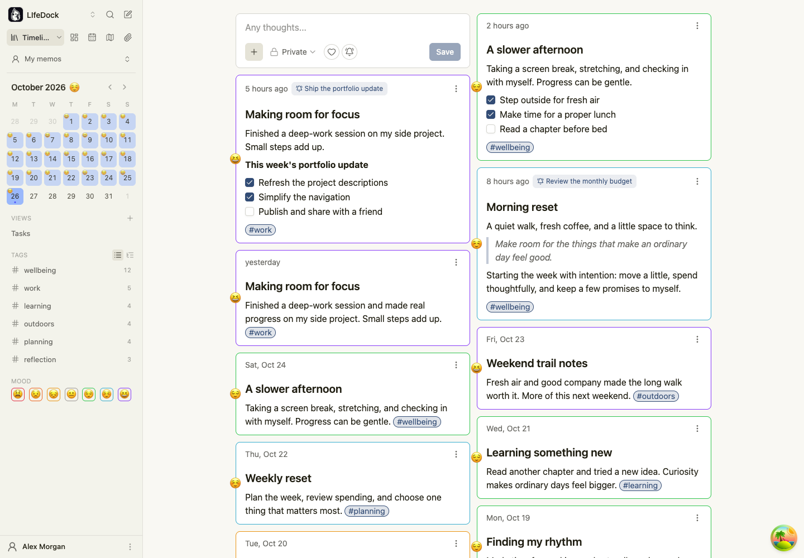
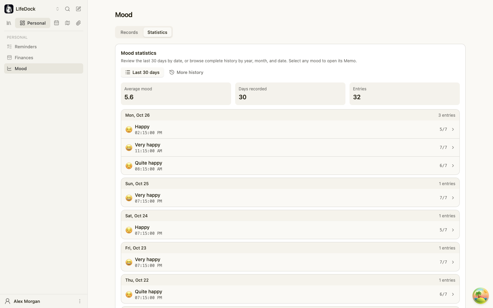
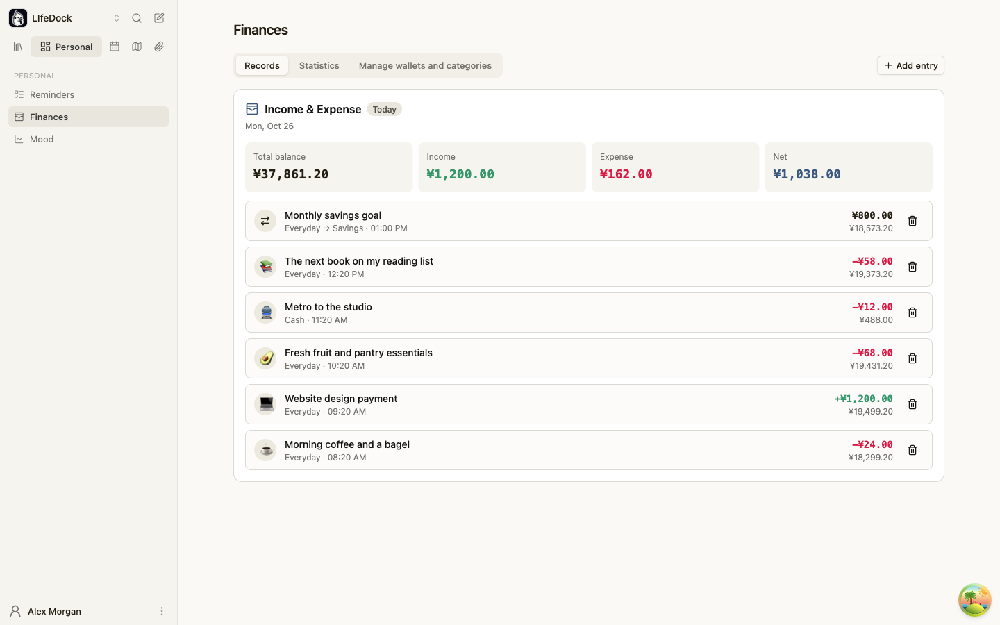
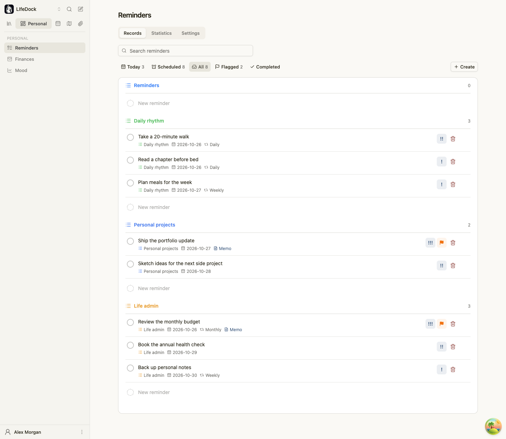

# LIfeDock

**把日常记录、心情、收支与提醒，收进同一个生活空间。**

LIfeDock 是一款开源、可自行部署的个人生活管理应用，基于 [Memos](https://github.com/usememos/memos) 扩展而来。
它保留了 Memos 轻量、便于快速记录、原生支持 Markdown 的特点，并将心情记录、个人财务和提醒事项融入日常使用，让记录与生活管理彼此连接。

你可以用它随手记下想法、回顾心情变化、整理日常收支，也可以把笔记中的计划变成提醒。数据存放在你自己的服务器上，由你掌控。

[安装与部署](fork-deploy.md) · [下载版本](https://github.com/BorisZhangYYY/LifeDock/releases) · [问题反馈](https://github.com/BorisZhangYYY/LifeDock/issues)

[English](../README.md) · 简体中文



## 功能特点

### 随手记录，慢慢积累

- **时间线笔记**：打开即写，用时间线串起日常想法、见闻和生活片段。
- **Markdown 编辑**：支持富文本与 Markdown 源码双模式，结合标签、附件、图片和语音记录整理内容。
- **搜索与筛选**：按标签、心情、附件或图片等条件查找记录，方便回顾。

### 看见自己的心情

- **心情记录**：在记录笔记时添加心情，也可以在独立心情页面查看历史与统计。
- **日历回顾**：通过每日与月度心情标注，观察一段时间里的情绪变化。
- **个性化表达**：自定义各档心情的表情与颜色，让记录更贴近自己的感受。



按日期回顾心情记录，查看最近 30 天的平均心情、记录天数与条目总数；点击具体心情即可回到关联笔记。

### 理清日常收支

- **钱包与分类**：管理多个钱包和收支分类，记录收入、支出、转账与余额校准。
- **收支回顾**：查看当日数据、历史流水与统计，了解钱花在哪里。



在同一页面查看总余额、当日收入、支出与净额。示例展示了日常消费、自由职业收入，以及从日常钱包转入储蓄钱包的转账。

### 让计划得到提醒

- **提醒清单**：支持分组、日期与时间、提前提醒、重复规则、优先级和旗标。
- **关联笔记**：把提醒与相关笔记连接起来，保留计划背后的上下文。
- **通知与回顾**：提供站内通知和可选的 SMTP 邮件通知，并保留完成历史与统计。



按日常习惯、个人项目与生活事务分组管理提醒，结合日期、重复规则、优先级、旗标与关联笔记，让计划保留上下文。

### 自己部署，自由连接

- **掌控数据**：在自己的服务器上部署，支持用户数据导出与导入。
- **灵活运行**：通过单个 Go 可执行文件或 Docker 容器运行，支持 SQLite、MySQL 和 PostgreSQL。
- **可见性管理**：可关闭公开访问；个人看板与标签笔记还可配置额外的界面访问验证。
- **开放集成**：保留 REST 和 gRPC API，并提供 MCP 服务，让智能体协助记录、查询与管理生活信息。

个人看板与标签笔记的访问验证用于保护界面显示，不改变笔记的分享权限，也不对数据加密。具体行为见[个人内容隐私说明](fork-deploy.md#个人内容隐私)。

## 快速开始

### Docker 部署（推荐）

```bash
docker run -d \
  --name memos \
  -p 5230:5230 \
  -v ~/.memos:/var/opt/memos \
  ghcr.io/boriszhangyyy/memos:stable
```

打开 <http://localhost:5230>，注册第一个账号即可开始使用。第一个账号自动成为管理员，可在设置中关闭公开注册。

`~/.memos` 用于持久化应用数据。本项目沿用 `memos` 镜像仓库名与容器内数据路径，LIfeDock 镜像发布于 `ghcr.io/boriszhangyyy/memos`。

### 二进制与源码部署

从 [GitHub Releases](https://github.com/BorisZhangYYY/LifeDock/releases) 下载对应平台的可执行文件，或从本仓库源码构建。

完整安装步骤、升级方式、数据目录说明和 MCP 客户端配置，请参阅[安装与部署指南](fork-deploy.md)。

## 数据备份与迁移

在「设置 → 导出与导入」中，可以备份当前账号的笔记、评论、附件、个人资料与设置，以及心情、收支、提醒和通知记录。

导入前可预览记录数量，并选择保留、替换或创建副本。账号密码、登录令牌等身份凭据不参与迁移，详细范围见[用户数据导出与导入说明](fork-deploy.md#用户数据导出与导入)。

## 反馈与贡献

欢迎通过本仓库的 [Issues](https://github.com/BorisZhangYYY/LifeDock/issues) 提交问题与功能建议，也欢迎通过 [Pull Request](https://github.com/BorisZhangYYY/LifeDock/pulls) 改进代码、文档和翻译。

## 致谢与许可证

LIfeDock 基于开源项目 [Memos](https://github.com/usememos/memos) 开发，感谢 Memos 团队及社区贡献者提供的基础能力。
关于上游项目，可访问 [Memos 官网](https://usememos.com)与[官方文档](https://usememos.com/docs)；LIfeDock 的部署与扩展功能以本仓库文档为准。

本项目采用 [MIT 许可证](../LICENSE)，保留上游版权声明。
